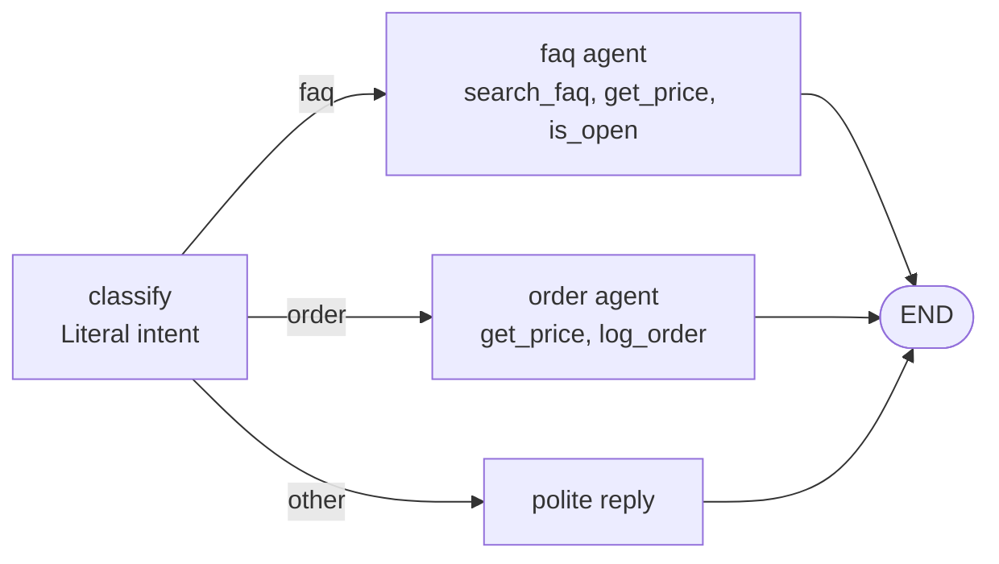
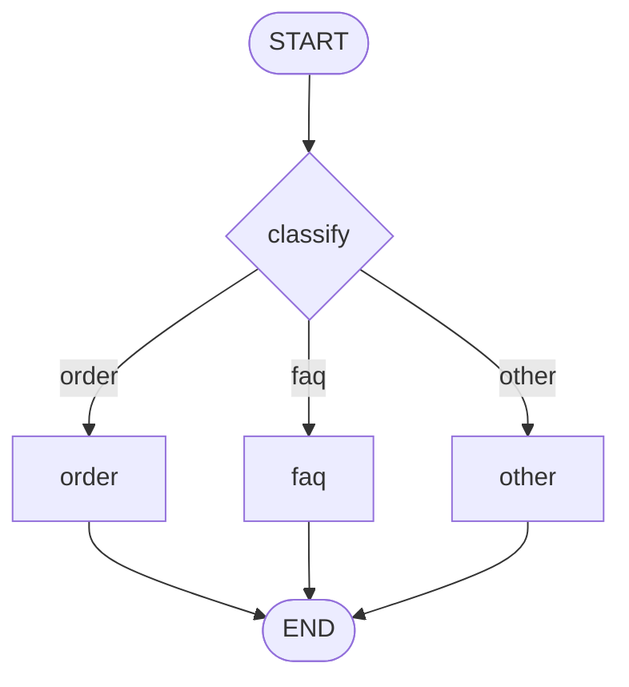
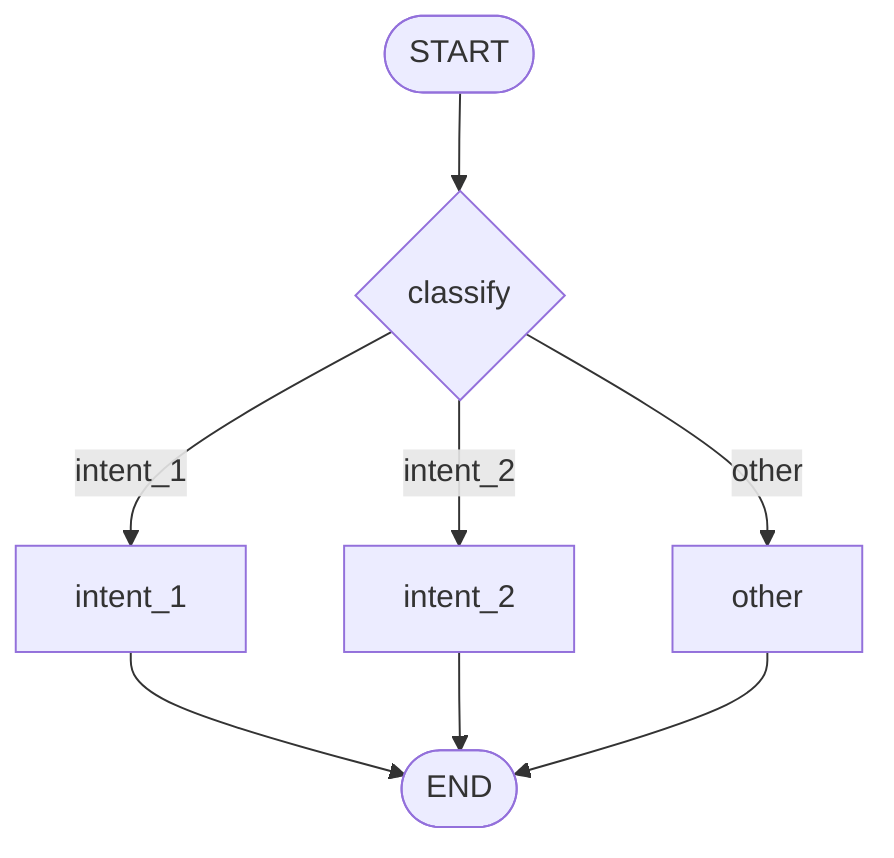

# Day 6 · Workflows, Planning and LangGraph
 
**AI Agents Workshop · Level 3 (Multi-agent) · Day 6, session 1 of 3**
Case study: **Sweet Crumbs Home Bakery**
 
Level 3 begins here. Before several agents can work as a team, we need a way to control the
path a message takes: which step runs first, who decides what happens next, and where it ends.
Today covers how agents plan, a router in plain Python, and the same router rebuilt as a
LangGraph workflow that can be drawn as a picture.
 
## Contents
 
1. [Workflows vs agents](#1-workflows-vs-agents)
2. [Planning techniques](#2-planning-techniques)
3. [A router in plain Python](#3-a-router-in-plain-python)
4. [LangGraph state](#4-langgraph-state)
5. [Nodes and edges](#5-nodes-and-edges)
6. [Conditional edges](#6-conditional-edges)
7. [Seeing the graph run](#7-seeing-the-graph-run)
8. [Agents inside a workflow](#8-agents-inside-a-workflow)
9. [Today's build: the Sweet Crumbs router](#9-todays-build-the-sweet-crumbs-router)
10. [My 50%](#10-my-50)
11. [Summary](#11-summary)
---
 
## 1. Workflows vs agents
 
In a **workflow**, you decide the steps in advance. In an **agent**, the model decides the steps as it goes.
Real systems mix both.
 
| | Workflow | Agent |
|---|---|---|
| Who decides the path? | You, in code | The model, at run time |
| Predictable? | Yes: same input, same steps | Less: it may take different steps |
| Good for | Known processes: order → check → save → confirm | Open questions: "help me plan a party order" |
| Sweet Crumbs | Every message is first sorted: order, question or other | Inside each path, the agent picks its tools |
 
**Usual pattern:** workflow on the outside, agents on the inside. Fix the big steps (sort, handle,
approve, save) and let agents handle the parts that need judgement.
 
- **Real world:** a bank loan is a workflow (application → document check → credit check → approval → disbursal).
  An AI agent may read the documents inside "document check", but it can't skip approval.
- **Analogy:** a train follows fixed tracks (workflow); an auto-rickshaw picks its own route (agent).
> **Remember:** Workflow = you fix the path. Agent = the model chooses the path.
> A rule that must never be skipped (like owner approval) belongs in the fixed path.
 
## 2. Planning techniques
 
| Technique | How it works | Good for |
|---|---|---|
| **Chain-of-Thought (CoT)** | Reason step by step before answering | Maths and logic in one reply, no tools |
| **ReAct** (Day 3) | Think → act with a tool → observe → repeat | Questions where each step depends on the last result |
| **Plan-and-Execute** | Write a numbered plan, do each step, then check | Bigger tasks with several parts, like a party order |
 
Example request: *"Diwali party for 40 people on Saturday: 20 cupcakes and 2 chocolate cakes, eggless. Total? Will delivery be free?"*
 
- **CoT:** `20 x 80 = 1600`, `2 x 650 = 1300`, total `2900` (from memory, so prices may be wrong).
- **ReAct:** `get_price` → `get_price` → `search_faq` → answer.
- **Plan-and-Execute:** 1 price cupcakes · 2 price cakes · 3 add · 4 delivery rule · 5 notice · 6 answer, then tick each off.
> **Remember:** CoT = think step by step in one reply. ReAct = think + tools in a loop.
> Plan-and-Execute = plan first, then do.
 
## 3. A router in plain Python
 
One LLM call sorts the message; `if/else` sends it down the right path.
 
```python
from typing import Literal
from pydantic import BaseModel, Field
 
class Intent(BaseModel):
    intent: Literal["order", "faq", "other"] = Field(
        description="order = wants to buy or book; faq = asks about prices, timings or policies; other = anything else")
 
classifier = llm.with_structured_output(Intent)        # Day 4: structured output
 
def handle(message: str) -> str:
    intent = classifier.invoke(message).intent         # 1. sort
    if intent == "order":                              # 2. route
        return take_order(message)
    elif intent == "faq":
        return answer_faq(message)
    else:
        return "I can help with cakes, orders and our policies. What would you like?"
```
 
The path is fixed in code; the model makes only one small decision. Plain `if/else` gets messy as
workflows grow (more steps, shared data, owner approval on Day 7, agent loops on Day 8), which is why we use LangGraph.
 
- **Analogy:** a hospital reception desk. It routes patients and treats no one.
> **Remember:** Router = classify once (structured output) + if/else.
 
## 4. LangGraph state
 
Every step reads from and writes to one shared dictionary called the **state**.
 
```python
from typing_extensions import TypedDict
 
class BakeryState(TypedDict):
    message: str     # what the customer wrote
    intent: str      # filled in by the classify step
    reply: str       # filled in by whichever path handles it
```
 
Each **node** receives the current state and returns **only the keys it changes**. LangGraph merges the update.
 
```
invoke({"message": "Do you deliver?"})   -> message filled
classify                                 -> adds intent: "faq"
faq                                      -> adds reply: "Yes, within 5 km..."
```
 
- **Analogy:** a job card at a car service centre, filled in step by step.
> **Remember:** State = one shared dict (`TypedDict`). A node returns e.g. `{"intent": "faq"}`, not the whole state.
 
## 5. Nodes and edges
 
A **node** is a step (a Python function). An **edge** is an arrow saying what comes next.
`START` and `END` mark where the graph begins and stops.
 
```python
from langgraph.graph import StateGraph, START, END
 
def classify(state: BakeryState) -> dict:
    return {"intent": classifier.invoke(state["message"]).intent}
 
def answer_faq(state: BakeryState) -> dict:
    return {"reply": "...answer from search_faq..."}
 
builder = StateGraph(BakeryState)          # 1. a new graph that uses our state
builder.add_node("classify", classify)     # 2. add the steps
builder.add_node("faq", answer_faq)
builder.add_edge(START, "classify")        # 3. connect them
builder.add_edge("classify", "faq")
builder.add_edge("faq", END)
graph = builder.compile()                  # 4. compile before running
 
result = graph.invoke({"message": "Do you deliver?"})
print(result["reply"])
```
 
- **Analogy:** a metro map. Stations are nodes, lines are edges.
- **Common mistake:** forgetting `add_edge(START, "classify")` leaves no entry point, so LangGraph raises an error.
> **Remember:** `StateGraph(State)` → `add_node` → `add_edge` → `compile()` → `invoke({...})`.
> Every node needs a path from `START` and a path to `END`.
 
## 6. Conditional edges
 
A **conditional edge** runs a small function to choose the next node. It is the `if/else` from section 3,
written as an arrow that splits.
 
```python
def route(state: BakeryState) -> str:
    return state["intent"]                 # "order", "faq" or "other"
 
builder.add_conditional_edges(
    "classify",                            # after this node...
    route,                                 # ...call this function...
    {"order": "order", "faq": "faq", "other": "other"},   # ...and go to the matching node
)
```
 
The routing function only reads the state and returns a label. It does no work.
If you add a new intent (for example `"complaint"`), add it to **both** the `Literal` and the mapping, with its own node.
 
- **Analogy:** a traffic officer at a junction: one road in, three roads out.
> **Remember:** `add_conditional_edges(from_node, route_fn, {label: node})`.
 
## 7. Seeing the graph run
 
Two habits make graphs easy to trust: **draw** it and **stream** it.
 
```python
from IPython.display import Image, display
display(Image(graph.get_graph().draw_mermaid_png()))     # the picture, inside Colab
 
for step in graph.stream({"message": "Do you deliver?"}, stream_mode="updates"):
    print(step)   # {'classify': {'intent': 'faq'}} then {'faq': {'reply': '...'}}
```
 
- The picture shows whether the arrows go where you meant.
- Streaming shows which node ran and what it changed. If a question goes down the wrong path,
  the first streamed line (the intent) tells you why. Fix the classifier's `Field(description=...)` or add a few-shot example.
- `invoke()` gives only the final result; `stream()` gives one line per step.
> **Note:** `draw_mermaid_png()` uses an online drawing service by default, so it needs internet.
 
## 8. Agents inside a workflow
 
Put a small agent inside each path. The workflow decides **which** agent handles the message; the agent decides **how**.
 
```python
faq_agent = create_agent(model=llm, tools=[search_faq, get_price, is_open],
                         system_prompt=FAQ_PROMPT)      # answers questions only
order_agent = create_agent(model=llm, tools=[get_price, log_order],
                           system_prompt=ORDER_PROMPT)  # takes orders only
 
def answer_faq(state: BakeryState) -> dict:
    result = faq_agent.invoke({"messages": [{"role": "user", "content": state["message"]}]})
    return {"reply": result["messages"][-1].content}
```
 
Each agent has fewer tools and a shorter, focused prompt. Fewer choices mean fewer wrong tool picks, and
some mistakes become impossible (the FAQ agent cannot save an order because it has no `log_order`).
 

 
**Next:** Day 7 adds owner approval between the paths; Day 8 adds a third agent and a supervisor.
 
## 9. Today's build: the Sweet Crumbs router
 

 
### Project files
 
```
day6-sweet-crumbs-router/
├── sweet_crumbs_router.py   # state, classifier, 2 agents, nodes, graph, runner
├── requirements.txt
├── .env.example
└── README.md
```
 
### Setup
 
```bash
python -m venv .venv
source .venv/bin/activate          # Windows: .venv\Scripts\activate
pip install -r requirements.txt
cp .env.example .env               # add OPENROUTER_API_KEY or OPENAI_API_KEY
```
 
In Google Colab, run `!pip install -q langgraph` after your Day 5 setup cells instead.
 
### Run
 
```bash
python sweet_crumbs_router.py            # saves graph.png, runs the test messages
python sweet_crumbs_router.py --chat     # type your own messages
python sweet_crumbs_router.py --draw     # only draw the graph
```
 
### Test it like a customer
 
| Message | Expected intent |
|---|---|
| "Do you deliver to my area?" | `faq` |
| "I'm Ravi, book 2 eggless plum cakes for 24 Dec" | `order` |
| "Good morning!" | `other` |
| "Is the plum cake nut-free?" | `faq` |
| "I want to know if you can make 2 cakes by tomorrow" | hard case: question or order? |
 
Also try "hi" and a Telugu-English mix. If one is routed wrongly, check the streamed intent, then improve
`Field(description=...)` or add a few-shot example (Day 2).
 
> **Limitation:** this graph has no conversation memory yet; each message is handled on its own.
> Day 7 adds a checkpointer so it remembers each customer and can pause for owner approval.
 
## 10. My 50%
 
Students do half of each session: draw first, then build.
 
1. Draw your workflow on paper; mark every decision as a diamond.
2. Write your own `TypedDict` state.
3. Build a `Literal` classifier for your business and a graph with at least 3 nodes and 1 conditional edge.
4. Draw the graph in Colab and compare it with your paper drawing. Fix any arrow that's different.
5. Send at least one real message down each branch and save the streamed output.
### My project: `<Business Name>`
 
**Paper drawing:** `docs/paper-workflow.jpg`
 
**State**
```python
class MyState(TypedDict):
    message: str
    intent: str
    reply: str
```
 
**Intents:** `<intent_1>`, `<intent_2>`, `other`
 
**Graph**

 
**Streamed output for each branch**
```
Customer: <message>
   {'classify': {'intent': '<intent>'}}
   {'<node>': {'reply': '...'}}
```
 
## 11. Summary
 
| Idea | One line | Analogy |
|---|---|---|
| Workflow vs agent | You fix the path vs the model chooses it | Train vs auto-rickshaw |
| Planning | CoT, ReAct, Plan-and-Execute | Show working, taste as you cook, wedding checklist |
| Plain router | Classify once, then if/else | Hospital reception |
| State | One shared dict; nodes return only what they change | Job card at a service centre |
| Nodes and edges | Steps and arrows, `START` to `END`, then `compile` | Metro map |
| Conditional edges | A function picks the next node | Traffic officer at a junction |
| Draw and stream | Picture of the graph; one update per step | Ball-by-ball replay |
| Agents in a workflow | Workflow routes, focused agents handle | College office departments |
 
 
